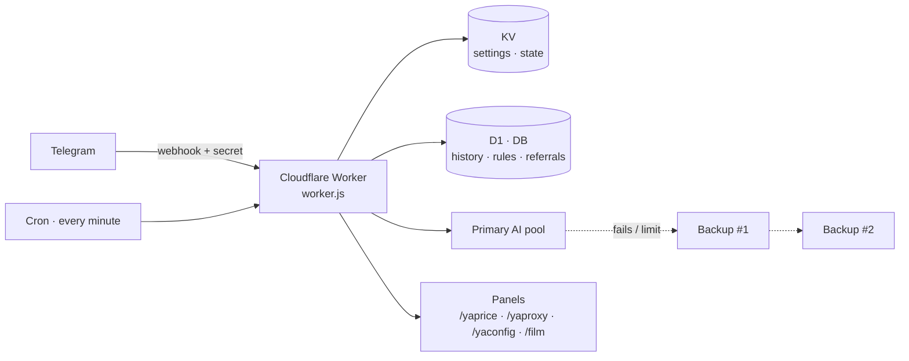

<div align="center">

# 🐕 YA Watchdog | سگ نگهبان

**ربات تلگرام برای نگهبانی گروه و دستیار هوش مصنوعی، روی یک Cloudflare Worker.**
یک فایل · بدون build · مناسب پلن رایگان · فارسی‌محور، ۹ زبان

[](LICENSE)


[**English**](README.md) · [**فارسی**](README.fa.md)

</div>

<div dir="rtl" align="right">

---

## ✨ امکانات

| | |
|---|---|
| 🛡 **مدیریت گروه** | سبک Rose: خوش‌آمد و خداحافظی، قوانین، اخطار، بن/کیک/میوت، قفل‌ها، لیست سیاه، فیلتر، یادداشت، ضداسپم، کپچا، پین/پاکسازی/گزارش |
| 🤖 **دستیار هوش مصنوعی** | ایجنت مالک با ابزار (زمان، خواندن لینک، یادداشت، یادآور) · دستیار بامزه برای بقیه · جواب به منشن در گروه · هر سرویس سازگار با OpenAI (پیش‌فرض OpenRouter) |
| 🔁 **AI همیشه روشن** | چرخش بین چند کلید + **چند سرویس پشتیبان که هرکدوم چند کلید دارن**؛ از داخل بات اضافه، مرتب، تست و حذف می‌شن (`/backup`) |
| 🔌 **AI شخصی** | کاربر و گروه می‌تونن سرویس/کلید/مدل خودشون رو با دکمه وصل کنن (`/myai`، `/setai`)؛ کلیدها رمزنگاری‌شده (AES-GCM) ذخیره می‌شن |
| 🌍 **۹ زبان** | رابط و جواب‌ها برای هر چت ترجمه می‌شه |
| 💱 **YAprice** | قیمت ارز، طلا و سکه **به تومان** — فقط بنویس «دلار»، «یورو»، «طلا»، «سکه»… |
| 📡 **YAProxy** | پروکسی MTProto تازه و تست‌شده با دکمه‌ی اتصال — بنویس «پروکسی» |
| 🆓 **YAconfig** | کانفیگ رایگان V2Ray/VLESS/VMess/Trojan + لینک اشتراک + پنل وب — بنویس «کانفیگ» یا «وی پی ان» |
| 🧠 **YA Dojo** | به بات بازخورد بده؛ اصلاح‌های تکراری تبدیل به قاعده‌ی نسخه‌دار می‌شن و روی همه‌ی جواب‌های AI اثر می‌ذارن — با امکان بازگشت |
| 🎬 **بقیه** | فیلم‌یاب (TMDB)، دانلودر (Cobalt)، خبرخوان RSS، پایش سایت/API، یادآور، هشدار قیمت، آرشیو، خلاصه‌ساز، فرم، ارسال همگانی، اتوپایلوت کانال، بازی‌ها، لینک ناشناس، پاداش دعوت |

> همه‌چیز از دکمه‌های شیشه‌ای در دسترسه: به بات `/menu` بفرست.

---

## 🚀 نصب

اول این چهار چیز رو آماده کن:

| چی | از کجا |
|---|---|
| **توکن بات** | [@BotFather](https://t.me/BotFather) ← `/newbot` |
| **آی‌دی عددی تلگرام تو** (`OWNER_ID`) | [@userinfobot](https://t.me/userinfobot) |
| **کلید API هوش مصنوعی** | [OpenRouter](https://openrouter.ai/keys) (کلید رایگان هم کافیه) یا هر سرویس سازگار با OpenAI |
| **یک رشته‌ی مخفی** (`WEBHOOK_SECRET`) | خودت بساز: حداقل ۱۶ کاراکتر از حروف، عدد، `_` یا `-` |

بعد **یکی** از این راه‌ها رو برو:

<details open>
<summary><b>📱 الف — با گوشی (یا PC): دکمه‌ی «Deploy to Cloudflare»</b></summary>

1. این لینک رو توی مرورگر باز کن (وارد کلودفلر شو؛ رایگانه):
   **`https://deploy.workers.cloudflare.com/?url=https://github.com/OWNER/REPO`**
   *(به‌جای `OWNER/REPO` آدرس همین ریپو رو بذار)*
2. ورکر، KV و D1 رو از روی `wrangler.toml` می‌سازه و مقدار سکرت‌های فایل `.dev.vars.example` رو ازت می‌پرسه.
3. برو به [بعد از نصب](#-بعد-از-نصب).

</details>

<details>
<summary><b>📱 ب — با گوشی (یا PC): نصب‌کننده‌ی <a href="https://jasaz.pages.dev">jasaz.pages.dev</a></b></summary>

Jasaz یک نصب‌کننده‌ی وب شخص‌ثالث برای ورکرهای کلودفلره (ساخته‌ی [yebekhe](https://github.com/itsyebekhe/jasaz)) و روی گوشی هم خوب کار می‌کنه.

1. **گام ۱** — **Account ID** کلودفلر و یک **API Token** وارد کن. از لینک «ساخت خودکار توکن API» خود صفحه استفاده کن (دسترسی ویرایش Workers Scripts، D1 و KV). بعد از نصب توکن رو پاک کن.
2. **گام ۲** — نام ورکر: هر چی (مثلاً `ya-watchdog`). **آدرس مستقیم سورس (Direct Raw URL):**
   `https://raw.githubusercontent.com/OWNER/REPO/main/worker.js`
   گزینه‌ی *مبهم‌سازی* رو **خاموش** نگه دار. برای آپدیت، *Clean Rebuild* رو **خاموش** بذار (وگرنه بایندینگ‌ها پاک می‌شن).
3. **گام ۳** — **D1** رو فعال کن (نام بایندینگ **`DB`**) و **KV** رو هم (نام بایندینگ **`KV`**). نام دیتابیس و namespace می‌تونه رندوم باشه.
4. **گام ۴** — استقرار. بعد توی داشبورد کلودفلر ← ورکرت:
   - **Settings ← Variables and Secrets:** مقدارهای `BOT_TOKEN`، `WEBHOOK_SECRET`، `OWNER_ID`، `AI_GATEWAY_API_KEY` (و `ENC_KEY`) رو اضافه کن.
   - **Settings ← Triggers ← Cron:** مطمئن شو `* * * * *` هست (نبود، اضافه‌ش کن).
5. برای آپدیت بعدی: Jasaz رو با **همون نام ورکر** دوباره اجرا کن.
6. برو به [بعد از نصب](#-بعد-از-نصب).

</details>

<details>
<summary><b>📱 پ — کپی‌پیست از داشبورد (روی گوشی «Desktop site» رو بزن)</b></summary>

1. داشبورد کلودفلر ← **Workers & Pages ← Create ← Worker ← Deploy** و بعد **Edit code**.
2. فایل [`worker.js`](worker.js) رو باز کن ← **Raw** ← انتخاب همه ← کپی ← جای کد ادیتور پیست کن ← **Deploy**. (حجم فایل حدود ۱٫۱ مگابایته؛ پیست چند ثانیه طول می‌کشه.)
3. **Settings ← Bindings:** یک **KV namespace** با نام متغیر `KV` و یک **D1 database** با نام متغیر `DB` اضافه کن.
4. **Settings ← Variables and Secrets:** `BOT_TOKEN`، `WEBHOOK_SECRET`، `OWNER_ID`، `AI_GATEWAY_API_KEY` (و `ENC_KEY`).
5. **Settings ← Triggers ← Cron:** `* * * * *`
6. برو به [بعد از نصب](#-بعد-از-نصب).

</details>

<details>
<summary><b>💻 ت — روی PC با Wrangler (مناسب برنامه‌نویس‌ها)</b></summary>

```bash
git clone https://github.com/OWNER/REPO.git ya-watchdog && cd ya-watchdog
npm install
npx wrangler login

# منابع (اگه نسخه‌ی wrangler هنگام deploy خودش می‌سازه، رد شو)
npx wrangler kv namespace create KV          # id رو توی wrangler.toml بذار
npx wrangler d1 create ya-watchdog-db        # database_id رو توی wrangler.toml بذار

# سکرت‌ها
npx wrangler secret put BOT_TOKEN
npx wrangler secret put WEBHOOK_SECRET
npx wrangler secret put OWNER_ID
npx wrangler secret put AI_GATEWAY_API_KEY
npx wrangler secret put ENC_KEY

npx wrangler deploy
```

تست محلی: `.dev.vars.example` رو به `.dev.vars` کپی کن، پر کن و `npm run dev` بزن.

</details>

### ✅ بعد از نصب

1. یک بار **`https://<ورکر-تو>/setup?key=<WEBHOOK_SECRET>`** رو باز کن؛ وب‌هوک تلگرام ثبت می‌شه.
2. توی **@BotFather**: `/setprivacy` ← *Disable* (و در صورت نیاز `/setinline` ← روشن).
3. به بات `/start` و بعد `/menu` بفرست.
4. **گروه‌ها:** بات رو اضافه کن، **ادمین** کن (حذف پیام، بن/محدودسازی، پین) و به‌عنوان مالک `/enable` رو همون‌جا بفرست.

> 💡 اگه `workers.dev` جایی که کاربرهات هستن فیلتره، یک **دامنه‌ی شخصی** به ورکر وصل کن (Settings ← Domains & Routes). پنل‌های وب (`/yaprice`، `/yaproxy`، `/yaconfig`، `/film`) از همون دامنه سرو می‌شن.

---

## ⚙️ تنظیمات

فقط چهار مورد اول اجباریه؛ بقیه اختیاریه و پیش‌فرض دارن.

<details open>
<summary><b>اجباری و پیشنهادی</b></summary>

| نام | نوع | توضیح |
|---|---|---|
| `KV` | بایندینگ | KV namespace — تنظیمات، وضعیت، کش |
| `BOT_TOKEN` | سکرت | توکن بات تلگرام |
| `WEBHOOK_SECRET` | سکرت | حداقل ۱۶ کاراکتر؛ بدون اون ورکر **503** می‌ده |
| `OWNER_ID` | متغیر | آی‌دی عددی مالک |
| `AI_GATEWAY_API_KEY` | سکرت | کلید اصلی AI (پیش‌فرض OpenRouter) |
| `DB` | بایندینگ | دیتابیس D1 — تاریخچه، دعوت‌ها، ترجمه‌ها، YA Dojo… |
| `ENC_KEY` | سکرت | رمزنگاری کلیدهایی که از داخل بات ذخیره می‌شن (اگه خالی باشه از `WEBHOOK_SECRET` استفاده می‌شه) |

</details>

<details>
<summary><b>هوش مصنوعی</b></summary>

| نام | پیش‌فرض | توضیح |
|---|---|---|
| `AI_GATEWAY_BASE_URL` | `https://openrouter.ai/api/v1` | هر آدرس سازگار با OpenAI `/chat/completions` |
| `AI_GATEWAY_API_KEYS` | – | کلیدهای اضافه‌ی اصلی (با کاما/فاصله/`;`) — با رسیدن به سقف می‌چرخن |
| `MODEL` | `openrouter/free` | مدل پیش‌فرض (از داخل بات با `/models` عوض می‌شه) |
| `AI_REASONING` | `off` | `off` · `low` · `medium` · `high` |
| `AI_MAX_TOKENS` | `900` | حداکثر توکن هر جواب |
| `AI_USER_DAILY_LIMIT` · `AI_GLOBAL_DAILY` | داخلی | سقف روزانه‌ی هر نفر و کل (روی حساب رایگان OpenRouter حدود ۴۰ بذار) |
| `AI_BACKUP_BASE_URL` · `AI_BACKUP_MODEL` · `AI_BACKUP_API_KEY(S)` | – | بکاپ اختیاری از طریق متغیر. **بهتره از `/backup` استفاده کنی** که چند سرویس و چند کلید داره |
| `TIMEZONE` | `Asia/Tehran` | برای زمان‌بندی و تاریخ |
| `APP_URL` · `APP_TITLE` | – | هدرهای معرفی اپ برای OpenRouter |

</details>

<details>
<summary><b>جستجو، صدا، دانلود، قیمت</b></summary>

| نام | توضیح |
|---|---|
| `BRAVE_API_KEY` · `TAVILY_API_KEY` · `LANGSEARCH_API_KEY` · `SEARXNG_URL` | سرویس جستجوی وب برای `/search` و جواب‌های AI (هرکدوم کافیه) |
| `STT_BASE_URL` · `STT_API_KEY` · `STT_MODEL` | تبدیل پیام صوتی به متن (پیش‌فرض `whisper-1`) |
| `BYNARA_API_KEY` · `BYNARA_BASE_URL` | روتر جایگزین اختیاری برای تبدیل صدا |
| `COBALT_API_URL` · `COBALT_API_KEY` | بک‌اند دانلودر `/dl` ([Cobalt](https://github.com/imputnet/cobalt)) |
| `COINGECKO_API_KEY` · `PRICE_RELAY` | گزینه‌های منبع قیمت رمزارز |

</details>

<details>
<summary><b>فیلم، بازی، کانال</b></summary>

| نام | توضیح |
|---|---|
| `TMDB_API_KEY` · `FILM_DB` (بایندینگ D1) · `BOT_USERNAME` | فیلم‌یاب؛ کلید فقط سمت سرور می‌مونه (پروکسی `/yatmdb/…`) |
| `ADMIN_CHAT_ID` | مقصد اعلان‌ها (پیش‌فرض `OWNER_ID`) |
| `GAME_URL` · `GAME_SHORT_NAME` · `GAME_ORIGIN` | پنل بازی گروهی (جدا هاست می‌شه) |
| `PUBLIC_URL` | آدرس عمومی ورکر، اگه خودکار تشخیص داده نشد |
| `X4_GEN_HOUR` · `X4_AUTOTR` | ساعت اجرای روزانه‌ی اتوپایلوت کانال · مقدار `off` ترجمه‌ی خودکار رو خاموش می‌کنه |

</details>

<details>
<summary><b>ماژول‌های YA و برندینگ</b></summary>

| نام | توضیح |
|---|---|
| `YAPRICE_JSON` · `YAPROXY_JSON` | به‌جای اسکرپرهای داخلی از JSON خودت استفاده کن (آدرس https) |
| `YAPRICE_URL` · `YAPROXY_URL` · `YACONFIG_URL` | لینک پنل‌ها در بات (پیش‌فرض: همین ورکر) |
| `YAPROXY_CHANNELS` | یوزرنیم کانال‌های عمومی برای اسکن پروکسی (با کاما) |
| `YACONFIG_SOURCE_URL` | آدرس ساب Base64 برای کانفیگ رایگان (پیش‌فرض: یک مخزن عمومی) |
| `YACONFIG_BUY_URL` · `YACONFIG_CHANNEL_URL` | اختیاری: دکمه‌ی «خرید کانفیگ اختصاصی» و لینک کانال. خالی = مخفی |
| `AUTO_PROMOTE` | `true` یعنی YA Dojo هر روز بازخوردهای تکراری رو خودکار به قاعده تبدیل کنه |
| `DONATE_RIAL` · `DONATE_TON` | لینک/آدرس حمایت برای `/donate`. خالی = «تنظیم نشده» |

</details>

---

## 🧰 دستورها

**`/menu`** منوی دکمه‌ای رو نشون می‌ده و **`/help`** لیست کامل.

| دستور | کار |
|---|---|
| `/start` · `/menu` · `/help` | شروع، منوی اصلی، همه‌ی دستورها |
| `/myai` · `/models` | وصل‌کردن AI خودت · انتخاب مدل |
| `/yaprice [all\|نام]` · `/yaproxy` · `/yaconfig` | نرخ به تومان · پروکسی MTProto · کانفیگ رایگان |
| `/price` · `/crypto` · `/alert` | قیمت، لیست رمزارز، هشدار قیمت |
| `/search` · `/tr` · `/dl` | جستجوی وب · ترجمه · دانلود |
| `/remind` · `/rem` · `/archive` · `/notes` | یادآور، آرشیو، یادداشت |
| `/panel` · `/enable` | پنل تنظیمات گروه · فعال‌سازی بات در گروه (مالک) |
| `/backup` · `/usage` · `/diag` · `/ya` | مالک: سرویس‌های پشتیبان AI · مصرف · عیب‌یابی · YA Dojo |
| `/ref` · `/donate` · `/joke` | لینک دعوت (+سهمیه‌ی AI) · حمایت · جوک |

**فقط بنویس:** «دلار» · «یورو» · «طلا» · «سکه» · «پروکسی» · «کانفیگ» · «وی پی ان» — بات با قیمت، پروکسی یا کانفیگ و دکمه جواب می‌ده.

---

## 🧩 ماژول‌های YA

<details>
<summary><b>💱 YAprice</b> — نرخ به تومان</summary>

- پنل: `/yaprice` · JSON: `/yaprice/market.json` · بات: `/yaprice` یا نام ارز/طلا.
- کران هر حدود ۱۰ دقیقه یک‌سوم دارایی‌ها رو تازه می‌کنه (پس بروزرسانی کامل حدود ۳۰ دقیقه‌ست و توی محدودیت پلن رایگان می‌مونه). برای پر شدن اولیه یک بار `/yaprice/refresh?key=WEBHOOK_SECRET&all=1` رو باز کن.
- داده از صفحه‌های عمومی گرفته می‌شه؛ اگه منبعی IP کلاودفلر رو بست، `market.json` خودت رو هاست کن و `YAPRICE_JSON` رو بذار.

</details>

<details>
<summary><b>📡 YAProxy</b> — پروکسی MTProto</summary>

- هر ساعت کانال‌های عمومی تلگرام رو می‌خونه، لینک‌ها رو اعتبارسنجی می‌کنه و با `cloudflare:sockets` اتصال TCP رو تست می‌کنه.
- پنل `/yaproxy` · JSON ‏`/yaproxy/extracted_proxies.json` · بات: بنویس «پروکسی».

</details>

<details>
<summary><b>🆓 YAconfig</b> — کانفیگ رایگان V2Ray</summary>

- پنل `/yaconfig` · اشتراک‌ها `/yaconfig/sub/{mixed|vless|vmess|trojan|ss|hy2|tuic|high_speed}` (و `/yaconfig/sub/base64/…`).
- توی چت: «کانفیگ»، «وی پی ان»، «v2ray»… ← پنج کانفیگ با کپی با یک لمس + دکمه‌ها (*پنل وب*، و اختیاری *خرید کانفیگ اختصاصی*).
- کانفیگ رایگان عمومی **تضمین سرعت و پایداری نداره** — بات هم همین رو می‌گه.

</details>

<details>
<summary><b>🧠 YA Dojo</b> — یادگیری از اصلاح‌های تو</summary>

- فقط مالک: `/ya` (با دکمه) · `/ya feedback <متن>` · `/ya good <متن>` · `/ya analyze` · `/ya improve` · `/ya history` · `/ya rollback <id>` · `/ya auto on|off`.
- یک اصلاحِ یکسان وقتی دو بار ثبت بشه تبدیل به قاعده می‌شه؛ قاعده‌های فعال به پرامپت همه‌ی جواب‌های AI اضافه می‌شن (به‌جز ترجمه و کارهای JSON). هر نسخه قابل بازگشته. به بایندینگ `DB` نیاز داره.

</details>

<details>
<summary><b>🛟 بکاپ چندگانه‌ی AI</b> — <code>/backup</code></summary>

- مالک، چت خصوصی. هر تعداد سرویس بذار (سرویس ← کلید ← مدل)، هرکدوم با چند کلید؛ جابه‌جایی اولویت، خاموش/روشن، تست، حذف.
- ترتیب: استخر اصلی ← بکاپ ۱ ← بکاپ ۲ ← … کلیدهای هر سرویس با زمان استراحت می‌چرخن.

</details>

---

## 🏗 معماری



یک ورکر با فرمت ماژول (`export default { fetch, scheduled }`)، بدون فریم‌ورک و بدون وابستگی.

---

## 🔒 امنیت و حریم خصوصی

- آپدیت‌های تلگرام فقط با هدر `WEBHOOK_SECRET` پذیرفته می‌شن؛ **بدون این سکرت ورکر اجرا نمی‌شه**.
- کلیدهای API ذخیره‌شده با AES-GCM رمزنگاری می‌شن و پیام‌های حاوی کلید از چت پاک می‌شن.
- دستورهای مخصوص مالک با `OWNER_ID` چک می‌شن (YA Dojo، مصرف، عیب‌یابی…)؛ پنل بکاپ فقط توی چت خصوصی کار می‌کنه تا کلید هیچ‌وقت توی گروه تایپ نشه.
- پروفایل‌سازی کاربر از روی اسم/بیو/منطقه **انجام نمی‌شه**؛ حالت‌های شوخی («تیکه/جنگ») عمداً ملایم‌اند (بدون فحش و توهین قومیتی/خانوادگی/مذهبی). الگوهای *تشخیص* فحش فارسی برای مدیریت گروه باقی مونده.
- مشکل امنیتی پیدا کردی؟ [SECURITY.md](SECURITY.md) رو ببین.

## 🩺 عیب‌یابی

| نشانه | راه‌حل |
|---|---|
| هر آدرسی «Setup required» (503) می‌ده | سکرت `WEBHOOK_SECRET` (حداقل ۱۶ کاراکتر) رو اضافه و دوباره deploy کن |
| بات توی گروه ساکته | ادمینش کن · BotFather `/setprivacy` ← Disable · مالک توی گروه `/enable` بزنه |
| بات همه‌جا ساکته | دوباره `/setup?key=…` رو باز کن · توکن رو چک کن · `/diag` |
| «AI تنظیم نشده» | `AI_GATEWAY_API_KEY` رو بذار یا مالک با `/backup` سرویس اضافه کنه |
| امکانات D1 می‌گن «DB وصل نیست» | بایندینگ D1 با نام `DB` اضافه کن |
| قیمت‌ها/پروکسی‌ها خالیه | چند دقیقه صبر کن تا کران اجرا بشه یا آدرس `/…/refresh?key=…` رو بزن؛ اگه منبعی کلودفلر رو بست از `YAPRICE_JSON` / `YAPROXY_JSON` استفاده کن |

## 🤝 مشارکت

Issue و Pull Request خوش‌آمده. پروژه رو بدون وابستگی نگه دار و قبل از push دستور `npm run check` رو بزن.

## 📜 مجوز

[MIT](LICENSE) © 2026 UnchartedAli

## 🙏 قدردانی و تذکرات

- کانفیگ‌های رایگان از [itsyebekhe/PSG](https://github.com/itsyebekhe/PSG) جمع می‌شن و نصب‌کننده‌ی [Jasaz](https://github.com/itsyebekhe/jasaz) هم از همون سازنده‌ست. قبل از بازتوزیع داده‌شون مجوزشون رو چک کن.
- نرخ‌ها از صفحه‌های عمومی (مثل alanchand.com) خونده می‌شه — قوانین‌شون رو رعایت کن یا فید خودت رو بده.
- داده‌ی فیلم: *This product uses the TMDB API but is not endorsed or certified by TMDB.*
- AI از [OpenRouter](https://openrouter.ai) یا هر سرویس سازگار با OpenAI؛ دانلود با [Cobalt](https://github.com/imputnet/cobalt)؛ قیمت رمزارز از CoinGecko.

</div>
