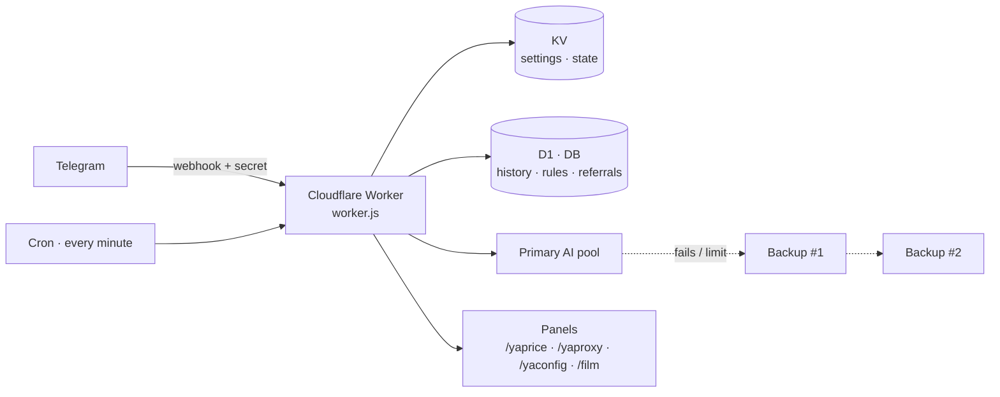

<div align="center">

# 🐕‍🦺 YA Watchdog

**A Telegram group guard + AI assistant that runs on a single Cloudflare Worker.**
One file · no build step · free-tier friendly · Persian-first, 9 UI languages.
**My channel: [@yamods](https://t.me/yamods)**

[](LICENSE)


[**English**](README.md) · [**فارسی**](README.fa.md)

[Install](#-install) · [Configuration](#-configuration) · [Commands](#-commands) · [YA modules](#-ya-modules) · [Security](#-security--privacy)

</div>

---

## ✨ Highlights

| | |
|---|---|
| 🛡 **Group moderation** | Rose-style: welcome/goodbye, rules, warns, ban/kick/mute, locks, blacklist, filters, notes, anti-flood, captcha, pin/purge/report |
| 🤖 **AI assistant** | Owner agent with tools (time, fetch URL, notes, reminders) · witty assistant for everyone else · answers when mentioned in groups · OpenAI-compatible providers (OpenRouter by default) |
| 🔁 **Never-down AI** | Key pool rotation + **several backup providers, each with several keys** — add, reorder, test and remove them from the bot (`/backup`) |
| 🔌 **Bring-your-own AI** | Users and groups can plug in their own provider/key/model with inline buttons (`/myai`, `/setai`) — keys are stored AES-GCM encrypted |
| 🌍 **9 languages** | UI and AI answers are translated per chat |
| 💱 **YAprice** | Currency, gold & coin prices **in toman** — just type `dollar`, `euro`, `gold`, `coin`… |
| 📡 **YAProxy** | Fresh, TCP-checked MTProto proxies with one-tap connect buttons — type `proxy` |
| 🆓 **YAconfig** | Free V2Ray/VLESS/VMess/Trojan configs + subscription links + web panel — type `config` or `vpn` |
| 🧠 **YA Dojo** | Give the bot feedback; repeated corrections become versioned rules that shape every AI reply — with rollback |
| 🎬 **Extras** | Movie finder (TMDB), downloader (Cobalt), RSS reader, site/API monitor, reminders, price alerts, archive, summaries, forms, broadcasts, channel autopilot, arcade games, anonymous links, referral bonuses |

> Everything is reachable from glass (inline) buttons: send `/menu` to the bot.

---

## 🚀 Install

You need four things first:

| What | Where to get it |
|---|---|
| **Bot token** | [@BotFather](https://t.me/BotFather) → `/newbot` |
| **Your numeric Telegram id** (`OWNER_ID`) | [@userinfobot](https://t.me/userinfobot) |
| **AI API key** | [OpenRouter](https://openrouter.ai/keys) (free keys work) or any OpenAI-compatible provider |
| **A secret string** (`WEBHOOK_SECRET`) | Make one up: 16+ characters, letters/digits/`_`/`-` — e.g. `openssl rand -hex 16` |

Then pick **one** way:

<details open>
<summary><b>📱 A — From your phone (or PC): “Deploy to Cloudflare” button</b></summary>

1. Open this link in your browser (log in to Cloudflare, it is free):
   **`https://deploy.workers.cloudflare.com/?url=https://github.com/UnchartedAli/watchDog`**
   *(replace `UnchartedAli/watchDog` with this repository)*
2. It creates the Worker, a KV namespace and a D1 database from `wrangler.toml`, and asks for the secrets listed in `.dev.vars.example`.
3. Go to [After deploying](#-after-deploying).

</details>

<details>
<summary><b>📱 B — From your phone (or PC): <a href="https://jasaz.pages.dev">jasaz.pages.dev</a> installer</b></summary>

Jasaz is a third-party web installer for Cloudflare Workers (by [yebekhe](https://github.com/itsyebekhe/jasaz)). It works fine on a phone.

1. **Step 1** – enter your Cloudflare **Account ID** and an **API token**. Use the page's *auto-create token* link (Workers Scripts, D1 and KV edit). Delete the token when you are done.
2. **Step 2** – worker name: anything (e.g. `ya-watchdog`). **Direct Raw URL:**
   `https://raw.githubusercontent.com/UnchartedAli/watchDog/main/worker.js`
   Keep *Obfuscator* **off**. Leave *Clean rebuild* **off** when you are only updating (it would wipe bindings).
3. **Step 3** – enable **D1** (binding name **`DB`**) and **KV** (binding name **`KV`**). Random names for the database/namespace are fine.
4. **Step 4** – deploy. Then, in the Cloudflare dashboard → your Worker:
   - **Settings → Variables and Secrets:** add `BOT_TOKEN`, `WEBHOOK_SECRET`, `OWNER_ID`, `AI_GATEWAY_API_KEY` (and `ENC_KEY`).
   - **Settings → Triggers → Cron:** make sure `* * * * *` exists (add it if not).
5. To update later: run Jasaz again with the **same worker name**.
6. Go to [After deploying](#-after-deploying).

</details>

<details>
<summary><b>📱 C — Dashboard copy-paste (phone: use “Desktop site”)</b></summary>

1. Cloudflare dashboard → **Workers & Pages → Create → Worker → Deploy**, then **Edit code**.
2. Open [`worker.js`](worker.js) → **Raw** → select all → copy → paste over the editor → **Deploy**. (The file is ~1.1 MB; pasting can take a few seconds.)
3. **Settings → Bindings:** add a **KV namespace** with variable name `KV`, and a **D1 database** with variable name `DB`.
4. **Settings → Variables and Secrets:** add `BOT_TOKEN`, `WEBHOOK_SECRET`, `OWNER_ID`, `AI_GATEWAY_API_KEY` (and `ENC_KEY`).
5. **Settings → Triggers → Cron:** `* * * * *`
6. Go to [After deploying](#-after-deploying).

</details>

<details>
<summary><b>💻 D — PC with Wrangler (recommended for developers)</b></summary>

```bash
git clone https://github.com/UnchartedAli/watchDog.git ya-watchdog && cd ya-watchdog
npm install
npx wrangler login

# resources (skip if your wrangler version creates them automatically on deploy)
npx wrangler kv namespace create KV          # paste the id into wrangler.toml
npx wrangler d1 create ya-watchdog-db        # paste the database_id into wrangler.toml

# secrets
npx wrangler secret put BOT_TOKEN
npx wrangler secret put WEBHOOK_SECRET
npx wrangler secret put OWNER_ID
npx wrangler secret put AI_GATEWAY_API_KEY
npx wrangler secret put ENC_KEY

npx wrangler deploy
```

Local test: copy `.dev.vars.example` → `.dev.vars`, fill it in, run `npm run dev`.

</details>

### ✅ After deploying

1. Open **`https://<your-worker>/setup?key=<WEBHOOK_SECRET>`** once — it registers the Telegram webhook.
2. In **@BotFather**: `/setprivacy` → *Disable*, and `/setinline` → on (optional).
3. Open your bot and send `/start`, then `/menu`.
4. **Groups:** add the bot, make it **admin** (delete messages, ban/restrict, pin), then send `/enable` there as the owner.

> 💡 If `workers.dev` is filtered where your users live, attach a **custom domain** to the Worker (Settings → Domains & Routes). The web panels (`/yaprice`, `/yaproxy`, `/yaconfig`, `/film`) are served from that domain.

---

## ⚙️ Configuration

Only the first four are required. Everything else is optional and has a sensible default.

<details open>
<summary><b>Required & recommended</b></summary>

| Name | Type | Description |
|---|---|---|
| `KV` | binding | KV namespace — settings, state, caches |
| `BOT_TOKEN` | secret | Telegram bot token |
| `WEBHOOK_SECRET` | secret | 16+ chars. The worker returns **503** without it |
| `OWNER_ID` | var | Numeric Telegram id of the owner |
| `AI_GATEWAY_API_KEY` | secret | Primary AI key (OpenRouter by default) |
| `DB` | binding | D1 database — history, referrals, translations, YA Dojo… |
| `ENC_KEY` | secret | Encrypts API keys stored from the bot (falls back to `WEBHOOK_SECRET`) |

</details>

<details>
<summary><b>AI</b></summary>

| Name | Default | Description |
|---|---|---|
| `AI_GATEWAY_BASE_URL` | `https://openrouter.ai/api/v1` | Any OpenAI-compatible `/chat/completions` base URL |
| `AI_GATEWAY_API_KEYS` | – | Extra primary keys (comma/space/`;`) — rotated when one hits a limit |
| `MODEL` | `openrouter/free` | Default model (change it from the bot with `/models`) |
| `AI_REASONING` | `off` | `off` · `low` · `medium` · `high` |
| `AI_MAX_TOKENS` | `900` | Max tokens per answer |
| `AI_USER_DAILY_LIMIT` · `AI_GLOBAL_DAILY` | built-in | Per-user and global daily caps (use ~40 on a free OpenRouter account) |
| `AI_BACKUP_BASE_URL` · `AI_BACKUP_MODEL` · `AI_BACKUP_API_KEY(S)` | – | Optional env-based backup. **Prefer `/backup`**, which supports many providers and keys |
| `TIMEZONE` | `Asia/Tehran` | Used for schedules and dates |
| `APP_URL` · `APP_TITLE` | – | OpenRouter app attribution headers |

</details>

<details>
<summary><b>Search, voice, downloads, prices</b></summary>

| Name | Description |
|---|---|
| `BRAVE_API_KEY` · `TAVILY_API_KEY` · `LANGSEARCH_API_KEY` · `SEARXNG_URL` | Web-search providers for `/search` and AI answers (use any) |
| `STT_BASE_URL` · `STT_API_KEY` · `STT_MODEL` | Voice-message transcription (`whisper-1` by default) |
| `BYNARA_API_KEY` · `BYNARA_BASE_URL` | Optional alternative router used for voice transcription |
| `COBALT_API_URL` · `COBALT_API_KEY` | Downloader backend for `/dl` ([Cobalt](https://github.com/imputnet/cobalt)) |
| `COINGECKO_API_KEY` · `PRICE_RELAY` | Crypto price source options |

</details>

<details>
<summary><b>Movies, games, channels</b></summary>

| Name | Description |
|---|---|
| `TMDB_API_KEY` · `FILM_DB` (D1 binding) · `BOT_USERNAME` | Movie finder. The key stays on the server (`/yatmdb/…` proxy) |
| `ADMIN_CHAT_ID` | Where notifications go (defaults to `OWNER_ID`) |
| `GAME_URL` · `GAME_SHORT_NAME` · `GAME_ORIGIN` | Group arcade panel (hosted separately) |
| `PUBLIC_URL` | Public base URL of the worker, if it cannot be detected |
| `X4_GEN_HOUR` · `X4_AUTOTR` | Hour of the daily channel-autopilot run · set `off` to disable auto-translation |

</details>

<details>
<summary><b>YA modules & branding</b></summary>

| Name | Description |
|---|---|
| `YAPRICE_JSON` · `YAPROXY_JSON` | Use your own JSON feeds instead of the built-in scrapers (https URLs) |
| `YAPRICE_URL` · `YAPROXY_URL` · `YACONFIG_URL` | Panel links shown in the bot (default: this worker) |
| `YAPROXY_CHANNELS` | Comma-separated public channel usernames to scan for proxies |
| `YACONFIG_SOURCE_URL` | Base64 subscription URL for free configs (default: a public aggregator) |
| `YACONFIG_BUY_URL` · `YACONFIG_CHANNEL_URL` | Optional: “buy a dedicated config” button and channel link. Empty = hidden |
| `AUTO_PROMOTE` | `true` = YA Dojo promotes repeated feedback to rules automatically every day |
| `DONATE_RIAL` · `DONATE_TON` | Optional donation link / TON address for `/donate`. Empty = “not set” |

</details>

---

## 🧰 Commands

Send **`/menu`** for the glass-button hub, **`/help`** for the full list.

| Command | What it does |
|---|---|
| `/start` · `/menu` · `/help` | Onboarding, main menu, all commands |
| `/myai` · `/models` | Plug in your own AI · pick the model |
| `/yaprice [all\|name]` · `/yaproxy` · `/yaconfig` | Rates in toman · MTProto proxies · free V2Ray configs |
| `/price` · `/crypto` · `/alert` | Quotes, crypto list, price alerts |
| `/search` · `/tr` · `/dl` | Web search · translate · download media |
| `/remind` · `/rem` · `/archive` · `/notes` | Reminders, archive, notes |
| `/panel` · `/enable` | Group settings panel · enable the bot in a group (owner) |
| `/backup` · `/usage` · `/diag` · `/ya` | Owner: backup AI providers · usage · diagnostics · YA Dojo |
| `/ref` · `/donate` · `/joke` | Referral link (+AI quota) · support · a joke |

**Just type it:** `dollar` · `euro` · `gold` · `coin` · `proxy` · `config` · `vpn` — the bot answers with prices, proxies or configs and buttons.

---

## 🧩 YA modules

<details>
<summary><b>💱 YAprice</b> — rates in toman</summary>

- Panel: `/yaprice` · JSON: `/yaprice/market.json` · bot: `/yaprice`, or type a currency/gold name.
- A cron job refreshes one third of the assets about every 10 minutes (so a full refresh takes ~30 minutes and stays inside free-plan subrequest limits). Run `/yaprice/refresh?key=WEBHOOK_SECRET&all=1` once to fill everything.
- Data comes from public pages; if a source blocks Cloudflare IPs, host your own `market.json` and set `YAPRICE_JSON`.

</details>

<details>
<summary><b>📡 YAProxy</b> — MTProto proxies</summary>

- Scans public Telegram channels hourly, validates links, and TCP-checks proxies with `cloudflare:sockets`.
- Panel `/yaproxy` · JSON `/yaproxy/extracted_proxies.json` · bot: type `proxy`.

</details>

<details>
<summary><b>🆓 YAconfig</b> — free V2Ray configs</summary>

- Panel `/yaconfig` · subscriptions `/yaconfig/sub/{mixed|vless|vmess|trojan|ss|hy2|tuic|high_speed}` (+ `/yaconfig/sub/base64/…`).
- In chat: `config`, `vpn`, `v2ray` … → five configs by tap-to-copy, plus buttons (*Web panel*, optional *Buy a dedicated config*).
- Free public configs have **no stability or speed guarantee** — the bot says so.

</details>

<details>
<summary><b>🧠 YA Dojo</b> — learn from your corrections</summary>

- Owner-only: `/ya` (buttons) · `/ya feedback <text>` · `/ya good <text>` · `/ya analyze` · `/ya improve` · `/ya history` · `/ya rollback <id>` · `/ya auto on|off`.
- The same correction recorded twice becomes a rule; active rules are appended to the system prompt of every AI call (translation/JSON tasks excluded). Every version can be rolled back. Needs the `DB` binding.

</details>

<details>
<summary><b>🛟 Multi-backup AI</b> — <code>/backup</code></summary>

- Owner, private chat. Add as many providers as you like (service → key → model), each with several keys; reorder, pause, test, delete.
- Order: primary pool → backup #1 → backup #2 → … Keys inside a provider rotate with cooldowns.

</details>

---

## 🏗 Architecture



One module-format Worker (`export default { fetch, scheduled }`), no framework, no dependencies.

---

## 🔒 Security & privacy

- Telegram updates are accepted only with the `WEBHOOK_SECRET` header; **without the secret the worker refuses to run**.
- Stored API keys are AES-GCM encrypted; key messages sent to the bot are deleted from the chat.
- Owner-only commands are checked against `OWNER_ID` (YA Dojo, usage, diagnostics…); the backup panel works in private chat only, so keys are never typed in a group.
- User profiling by name/bio/region is **not** done; playful “roast/war” modes are mild by design (no profanity, no ethnic/family/religious insults). Persian profanity *detection* patterns are kept for moderation.
- Found a problem? See [SECURITY.md](SECURITY.md).

## 🩺 Troubleshooting

| Symptom | Fix |
|---|---|
| Any URL shows “Setup required” (503) | Add the `WEBHOOK_SECRET` secret (16+ chars) and redeploy |
| Bot silent in a group | Make it admin · BotFather `/setprivacy` → Disable · owner sends `/enable` in the group |
| Bot silent everywhere | Open `/setup?key=…` again · check the token · see `/diag` |
| “AI not configured” | Set `AI_GATEWAY_API_KEY`, or the owner adds a provider with `/backup` |
| D1 features say “DB not connected” | Add a D1 binding named `DB` |
| Prices/proxies empty | Wait a few minutes for the cron, or call the `/…/refresh?key=…` URL; if a source blocks Cloudflare, use `YAPRICE_JSON` / `YAPROXY_JSON` |

## 🤝 Contributing

Issues and pull requests are welcome. Keep it dependency-free and run `npm run check` before you push.

## 📜 License

[MIT](LICENSE) © 2026 UnchartedAli

## 🙏 Credits & notices

- Free configs are aggregated by [itsyebekhe/PSG](https://github.com/itsyebekhe/PSG); the [Jasaz](https://github.com/itsyebekhe/jasaz) installer is by the same author. Check their licenses before redistributing their data.
- Rates are read from public pages (e.g. alanchand.com) — respect their terms or supply your own feed.
- Movie data: *This product uses the TMDB API but is not endorsed or certified by TMDB.*
- AI via [OpenRouter](https://openrouter.ai) or any OpenAI-compatible provider; downloads via [Cobalt](https://github.com/imputnet/cobalt); crypto prices via CoinGecko.
